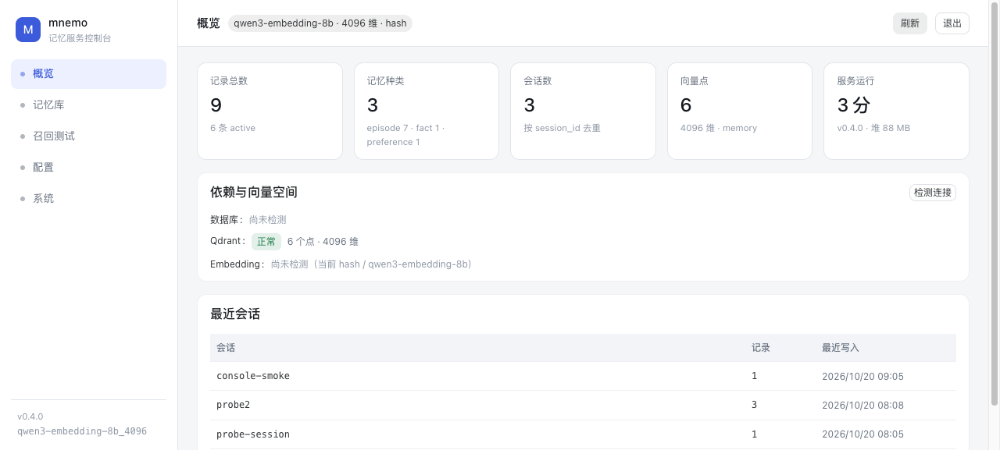
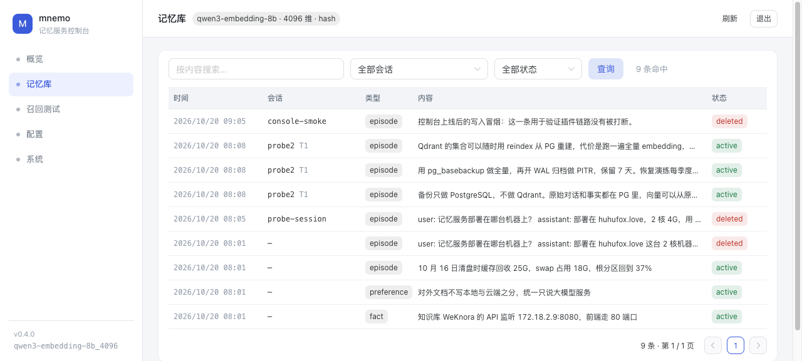
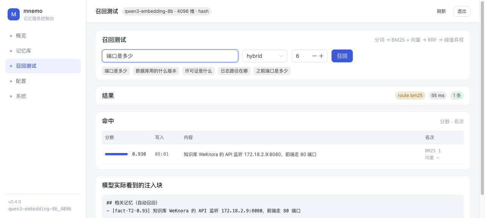

<p align="center">
  
</p>

<h1 align="center">mnemo</h1>

<p align="center">Self-hosted long-term memory for AI agents.</p>

<p align="center">
  <a href="https://hub.docker.com/r/yejiu233/mnemo"></a>
  <a href="https://www.npmjs.com/package/@cmnyhh/dsh-mnemo"></a>
  <a href="LICENSE"></a>
</p>

<p align="center">
  English · <a href="README.zh-CN.md">简体中文</a>
</p>

---

Conversational assistants generally handle memory in one of two ways: they forget everything between sessions, or they replay the entire transcript until the context window and the bill become the limit. mnemo takes a third approach — it keeps a durable store of what was decided, and returns only the entries relevant to the current request.

It runs on your own hardware. Data stays in your PostgreSQL and Qdrant instances, and the model endpoints are yours to choose or to omit.

## Quick start

```bash
git clone https://github.com/cmnyhh/mnemo.git && cd mnemo
./scripts/setup-env.sh    # generates credentials and prints them once
docker compose up -d
```

The setup script prints the following:

| Entry | Address | Account | Secret |
| --- | --- | --- | --- |
| Console | <http://localhost:8090> | `admin` | generated, shown once |
| PostgreSQL | `127.0.0.1:5432` | `memory` (database `memory`) | `POSTGRES_PASSWORD` |
| Qdrant | `127.0.0.1:6333` | none | header `api-key: $QDRANT_API_KEY` |
| Memory API | `/v1/memory/*` | none | `mn_…` token issued in the console |

All secrets live in `.env`. Editing `.env` after the first start does not reset the console password: it is written to the database on first boot and changed from the console afterwards. To configure manually instead, follow the comments in `.env.example`.

Images are built by GitHub Actions on version tags and published to [Docker Hub](https://hub.docker.com/r/yejiu233/mnemo), which is what `docker compose up` pulls by default. Nothing is built on ordinary commits. To build from source instead, add the build overlay — the first build takes roughly ten minutes:

```bash
docker compose -f docker-compose.yml -f docker-compose.build.yml up -d --build
```

Open <http://localhost:8090>, sign in, issue a token on the **Tokens** page, then use **Recall** to run a query.

Read and write through the API:

```bash
TOKEN=mn_your_token

curl -X POST http://localhost:8090/v1/memory/ingest \
  -H "Authorization: Bearer $TOKEN" -H 'content-type: application/json' \
  -d '{"kind":"fact","narrative":"The service listens on 8090 behind an HTTPS reverse proxy","importance":0.8}'

curl -X POST http://localhost:8090/v1/memory/search \
  -H "Authorization: Bearer $TOKEN" -H 'content-type: application/json' \
  -d '{"query":"which port does the service use"}'
```

The second call returns the entry just written, together with its score, the retrieval path that produced it, and an `injection` block ready to be placed in a prompt.

## Docker Compose deployment

The repository ships a compose file with three services — `db` (PostgreSQL 18 with BM25), `qdrant`, and `service`. On a server that has Docker and Compose v2, two files are enough and nothing has to be cloned.

`compose.yaml`:

```yaml
name: memory

services:
  db:
    image: yejiu233/mnemo-db:18
    restart: unless-stopped
    shm_size: 256mb
    mem_limit: 768m
    environment:
      POSTGRES_DB: memory
      POSTGRES_USER: memory
      POSTGRES_PASSWORD: ${POSTGRES_PASSWORD:?set POSTGRES_PASSWORD in .env}
      TZ: Asia/Shanghai
    command:
      - postgres
      - -c
      - shared_buffers=384MB
      - -c
      - maintenance_work_mem=128MB
      - -c
      - effective_cache_size=1536MB
      - -c
      - shared_preload_libraries=pg_textsearch
    volumes:
      - pgdata:/var/lib/postgresql
    healthcheck:
      test: ["CMD-SHELL", "pg_isready -U memory -d memory"]
      interval: 10s
      timeout: 5s
      retries: 12
      start_period: 20s
    ports:
      - "127.0.0.1:5432:5432"

  qdrant:
    image: qdrant/qdrant:v1.12.4
    restart: unless-stopped
    mem_limit: 320m
    environment:
      QDRANT__SERVICE__API_KEY: ${QDRANT_API_KEY:?set QDRANT_API_KEY in .env}
      QDRANT__STORAGE__ON_DISK_PAYLOAD: "true"
      QDRANT__TELEMETRY_DISABLED: "true"
    volumes:
      - qdrant:/qdrant/storage
    ports:
      - "127.0.0.1:6333:6333"

  service:
    image: yejiu233/mnemo:1.4.9
    restart: unless-stopped
    mem_limit: 1280m
    environment:
      MEMORY_DB_URL: jdbc:postgresql://db:5432/memory
      MEMORY_DB_USER: memory
      MEMORY_DB_PASSWORD: ${POSTGRES_PASSWORD}
      MEMORY_QDRANT_URL: http://qdrant:6333
      MEMORY_QDRANT_API_KEY: ${QDRANT_API_KEY}
      MEMORY_TENANT: ${MEMORY_TENANT:-default}
      MEMORY_ADMIN_USERNAME: ${MEMORY_ADMIN_USERNAME:-admin}
      MEMORY_ADMIN_PASSWORD: ${MEMORY_ADMIN_PASSWORD:-}
      MEMORY_ADMIN_COOKIE_SECURE: ${MEMORY_ADMIN_COOKIE_SECURE:-auto}
      MEMORY_EMBEDDING_PROVIDER: ${EMBEDDING_PROVIDER:-hash}
      MEMORY_EMBEDDING_BASE_URL: ${EMBEDDING_BASE_URL:-}
      MEMORY_EMBEDDING_API_KEY: ${EMBEDDING_API_KEY:-}
      MEMORY_EMBEDDING_MODEL: ${EMBEDDING_MODEL:-qwen3-embedding-8b}
      MEMORY_EMBEDDING_DIMS: ${EMBEDDING_DIMS:-4096}
      MEMORY_ASSETS_DIR: /data/assets
      TZ: Asia/Shanghai
    depends_on:
      db:
        condition: service_healthy
      qdrant:
        condition: service_started
    volumes:
      - assets:/data/assets
    ports:
      - "${MNEMO_PORT:-8090}:8080"
    healthcheck:
      test: ["CMD-SHELL", "wget -qO- http://127.0.0.1:8080/v1/memory/health >/dev/null || exit 1"]
      interval: 15s
      timeout: 5s
      retries: 3
      start_period: 40s

volumes:
  pgdata:
  qdrant:
  assets:
```

`.env` — only the two secrets are mandatory, every other variable has a default. The heredoc below lets the shell generate them:

```bash
cat > .env <<EOF
POSTGRES_PASSWORD=$(openssl rand -base64 24 | tr -d '\n')
QDRANT_API_KEY=$(openssl rand -base64 24 | tr -d '\n')
MEMORY_ADMIN_PASSWORD=$(openssl rand -base64 18 | tr -d '\n')
EOF
chmod 600 .env
docker compose up -d
docker compose ps        # wait for service to report healthy
```

`MEMORY_ADMIN_PASSWORD` is read on first boot and written to the database; editing `.env` later does not change it — change it from the console.

Points worth knowing before putting it on a network:

- **Only `service` is published.** PostgreSQL and Qdrant bind to `127.0.0.1`, and `service` listens on `0.0.0.0:8090` so a reverse proxy in another container can reach it. Put HTTPS in front before exposing it, or change the mapping to `127.0.0.1:8090:8080`.
- **Volume names carry the data.** The project name (`name: memory`) prefixes the three volumes; rename it and Compose mounts empty ones, which looks exactly like data loss.
- **Upgrade** is `docker compose pull && docker compose up -d`. The schema is idempotent and is applied at boot, so no migration step is needed.
- **Back up PostgreSQL**; vectors and full-text indexes are derived and can be rebuilt from it. If you use attachments, add the `assets` volume: `docker compose exec db pg_dump -U memory memory | gzip > memory-$(date +%F).sql.gz`.
- **Without the repository's `db/init` the service still works**: the required extensions are created on first boot.
- **Semantic recall needs an embedding endpoint.** The snippet defaults to `hash`, a local deterministic vector that only proves the pipeline works; point `EMBEDDING_PROVIDER=http` at an OpenAI-compatible endpoint (or set it later on the console **Config** page) to get real recall.

The full variable list, reverse-proxy examples and resource sizing are in [Operations](docs/operations.md).

## Connect an agent

The plugin is published on npm as [`@cmnyhh/dsh-mnemo`](https://www.npmjs.com/package/@cmnyhh/dsh-mnemo):

```bash
npm install @cmnyhh/dsh-mnemo
```

Package page: <https://www.npmjs.com/package/@cmnyhh/dsh-mnemo> · container images: <https://hub.docker.com/r/yejiu233/mnemo>

Without a plugin host, call the API directly:

```bash
curl -s -X POST https://<your-host>/v1/memory/search \
  -H "Authorization: Bearer $TOKEN" -H 'content-type: application/json' \
  -d '{"query":"the deployment plan we agreed on"}' | jq -r .injection
```

The plugin ([`plugin/`](plugin/README.md)) writes after each turn, injects before the next one, and registers recall as a tool the model can call on its own.

To teach a procedure rather than a fact, post the finished run to `/v1/memory/trajectories/record` with the goal, the steps and the outcome. Once that kind of task has succeeded often enough, `/v1/memory/skills/{name}` returns a ready-to-use `SKILL.md`.

## Capabilities

**Durable entries, not transcripts.** Conversations are reduced to discrete facts and preferences at write time, each with its own subject, validity and source. Entries can be superseded, forgotten, or pinned without touching the rest of the store.

**Recall that can decline.** Every request is scored, and when the best candidate does not clear the threshold, nothing is injected. A missing memory costs less than a wrong one.

**Tiered visibility.** Pinned entries are injected every turn, working-set entries expire with the session, the long-term tier is retrieved by default, and archived entries stay out of results until explicitly requested.

**Memory is data, not instructions.** Injected content is wrapped and labelled as historical record. Content arriving from external sources is downgraded and marked, so text that reads like a command does not acquire authority.

**Procedures that become skills.** Besides what happened, mnemo records how a task was done: each step keeps its action, observation, reflection and a value. When a run closes, the outcome is propagated back along the steps, with a concrete reflection weighing more than a vague one. Repeated success in the same kind of task becomes a strategy; a strategy with enough evidence is crystallised into a `SKILL.md` you can fetch and execute. Only successful runs are used, and a step whose observation reads like an instruction quarantines the whole strategy.

**Observed, not guessed.** Recall latency is reported per stage — embedding, keyword, vector, rerank — and exported at `/internal/metrics` for Prometheus; every console action lands in an audit log with actor, target and source address.

**Derived indexes.** PostgreSQL holds the record; vectors and full-text indexes can be rebuilt from it at any time, including after a model or dimension change.

**Retained history.** Superseded and forgotten entries remain queryable in the console under their own status. Their vector copies can be reclaimed from **System → Storage** without deleting the entries.

**One deployment, one tenant.** No simulated multi-tenancy. Tokens can be revoked or given an expiry, individual memories can be forgotten, and console credentials are independent of API tokens.

## Scope

A single mnemo instance serves one team on one host. It is not a distributed system, has no built-in replication, and does not partition data by end user. Deployments that need per-user isolation should run one instance per tenant.

## Console

The web console covers the full lifecycle without a CLI: browse entries, run recall tests, edit model configuration, issue tokens, rebuild indexes, and inspect storage usage.

<table>
  <tr>
    <td></td>
    <td></td>
  </tr>
  <tr>
    <td align="center">Records: origin turn and tier for every entry</td>
    <td align="center">Recall test: scores, channels, injection block</td>
  </tr>
</table>

## Requirements

Two vCPUs and 4 GB of RAM are sufficient. The three containers use about 360 MB at idle, and 30,000–50,000 entries remain comfortable. All state lives in Docker volumes; only PostgreSQL needs to be backed up. **System → Storage** reports the size of the database, the vector copies, the attachments, and the remaining disk.

Recall quality depends on two optional OpenAI-compatible endpoints: embeddings and reranking. An extraction model is also optional, and enables fact-level writes instead of paragraph splitting. None of the three is required — the service starts, accepts writes, and falls back to keyword retrieval without them.

## Documentation

| | |
| --- | --- |
| [Design](docs/design.md) | Retrieval, extraction, tiers, trust boundaries, data model |
| [Operations](docs/operations.md) | Configuration, console, tokens, backup, reverse proxy |
| [API](docs/api.md) | Every `/v1/memory/*` endpoint |
| [Development](docs/development.md) | Local setup, tests, builds, releases |
| [Plugin](plugin/README.md) | Installation, options, behaviour |

The `docs/` pages are currently written in Chinese.

## License

GNU Affero General Public License v3.0 or later — full text in [LICENSE](LICENSE). Copyright (c) 2026 mnemo contributors.

Commercial use is allowed, on one condition: whoever talks to the service over a network can obtain the source of the version actually running, including your modifications (AGPL §13). Running a modified mnemo as a closed service is not permitted. If that does not fit your case, a separate commercial licence can be discussed.

Releases up to `v1.2.0`, and the npm and image builds published before this change, remain under MIT — that grant cannot be withdrawn from copies already distributed.
